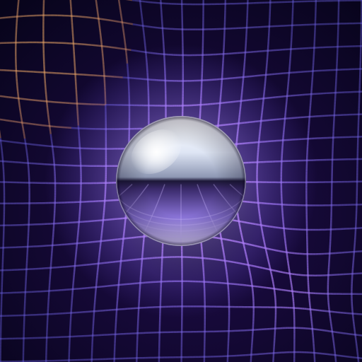

# Gravity Ball

Gra w odbijanie piłki (jak pong/arkanoid) w **zakrzywionej czasoprzestrzeni**. Tło to siatka z wgnieceniami i wybrzuszeniami, które wpływają na lot piłki:

- **wgniecenia** (fioletowe, ciemne) przyciągają piłkę i ją rozpędzają,
- **wybrzuszenia** (pomarańczowa poświata) odpychają ją i hamują,
- piłka zakręca jak piłka golfowa na pochyłym greenie, a pole powoli faluje i zmienia się po każdym punkcie.

Kąt odbicia zależy od miejsca trafienia w paletkę (jak w arkanoidzie). Gra toczy się do 7 punktów.

## Tryby
- **Gra z komputerem**: łatwy, średni, trudny (trudny komputer przewiduje lot po zakrzywionym polu).
- **Na jednym telefonie**: każdy gracz steruje palcem na swojej połowie ekranu.
- **Online**: jeden gracz tworzy pokój i wysyła link albo 4-cyfrowy kod, drugi dołącza. Telefony łączą się przez publiczne serwery MQTT (trzy naraz, gdy jeden nie działa, gra idzie przez pozostałe), więc gra działa i w wifi, i w sieci komórkowej. Po chwilowym zerwaniu (zgaszony ekran, słaby zasięg) gra czeka i sama wznawia się od miejsca przerwania. Po meczu przycisk **Następna gra** zaczyna kolejny bez ponownego łączenia.

## Sterowanie
- Na telefonie paletka podąża za palcem.
- **Mocne odbicie**: szybki ruch palcem w stronę rywala (prostopadle do paletki) wysuwa paletkę do przodu. Jeśli trafi wtedy w piłkę, piłka mocno przyspiesza.
- **Pauza**: stuknij w środek ekranu (na linii środkowej).
- Na komputerze sterujesz myszą albo strzałkami ←/→, mocne odbicie to ↑, a pauza to Spacja albo Esc. W trybie dla dwóch graczy górny gracz używa klawiszy A/D, a mocne odbicie to W.

## Uruchomienie
Cała gra to jeden plik `index.html` bez zależności. Na GitHub Pages działa od razu. Na iPhonie dodaj stronę do ekranu początkowego, wtedy gra uruchamia się na pełnym ekranie.
